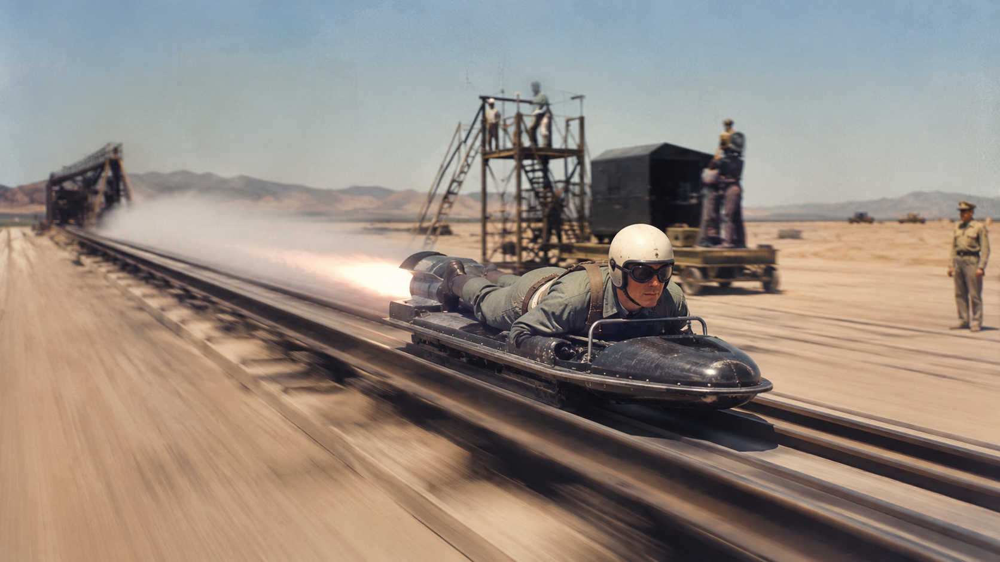
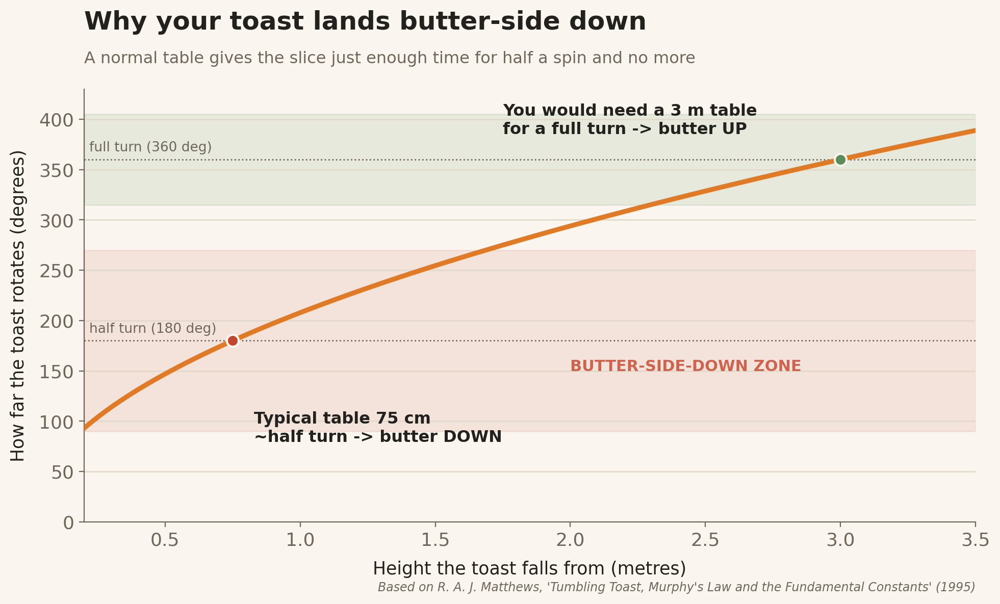
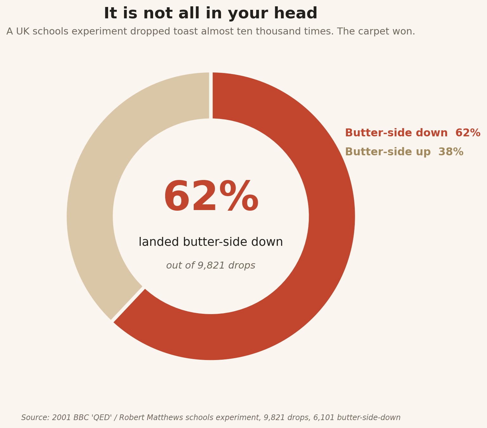

*Written at 2am, because the only honest time to write about everything going wrong is while something is.*

You know the moment. It is 2am. You have one small job left before bed. Save the file. Send the text. Carry the plate to the sink. And that is exactly when the laptop freezes, the message lands in the wrong chat, and the toast leaves your hand in slow motion and comes down, without fail, butter-side first, on the one rug you actually care about.

We have a name for that feeling. We say it under our breath like a curse and a prayer at the same time. Murphy's Law. Anything that can go wrong will go wrong.

Here is the part almost nobody knows. Murphy's Law was not handed down by some gloomy philosopher. It was born on a military base in the California desert, out of a near-fatal crash test, a backwards-wired sensor, and one very irritated engineer who never wanted his name anywhere near it. And the strangest twist of all is that the toast thing is real. A physicist proved it, won a prize for it, and the universe has been quietly smug about it ever since.

This is the story of how a complaint became a law.

## The desert, the sled, and the man who was not amused

In 1949, the United States Air Force was chewing on a brutal question. How much force can a human body survive before it comes apart? Jets were getting faster. Pilots were ejecting at speeds that had never existed before. Somebody had to find the limit, and the only honest way to find it was to build a machine that could nearly kill a volunteer and then stop just short.

That machine was a rocket sled nicknamed the Gee Whiz. It ran down a half-mile track at Edwards Air Force Base, hit speeds well past 200 miles per hour, then slammed to a halt in under a second. The man strapped to it was Colonel John Paul Stapp, a flight surgeon with a death wish dressed up as scientific curiosity. On one run he reached 632 miles per hour and took 46.2 G, which made him, for a while, the fastest human being on the ground. He finished test runs with broken bones, burst blood vessels, and detached retinas, and then he climbed back on.

Into this project walked Captain Edward A. Murphy Jr., an engineer from Wright Field. Murphy had designed a set of sensors, strain gauges, meant to measure the exact forces hitting Stapp's body during a run. On the day that matters, his assistant wired the four gauges into the harness, the sled fired, and the readout came back as a flat, useless zero. Every single sensor had been installed backwards.

That is the moment. Standing there, looking at a failed test and a wasted run on a one-of-a-kind machine, Murphy grumbled something close to the line that would outlive everyone in the room.

> If there is any way to do it wrong, he will find it.

It was a jab at a technician. It was not meant to be profound. Murphy got in his car, drove back home to Ohio, and as far as he knew, that was the end of it.

*Illustration, not an archival photograph.*

## How a grumble escaped the lab

Here is where it gets interesting. Stapp, the man on the sled, had a gift for a quote. At a later press conference, a reporter asked how nobody on such a dangerous project had been seriously hurt. Stapp credited the team's safety record to something he called Murphy's Law, and explained it roughly as the idea that anything that can go wrong, will. The reporters loved it. They wrote it down.

From there it spread the way good ideas spread, which is to say it stopped belonging to anyone. It turned up in aerospace trade articles in the 1950s. A character explained it in a 1958 stage play. Engineers adopted it as a design philosophy, because in their world a single thing going wrong could drop an aircraft out of the sky. By the time Arthur Bloch published his Murphy's Law books in the late 1970s, the phrase had hardened into folk wisdom, printed on mugs and office posters and bathroom walls all over the world.

The real Edward Murphy, by most accounts, hated it. He felt the popular version twisted his meaning. He had not been making a gloomy prophecy about an unfair universe. He had been making a flat engineering point. If a part can be installed two ways, and one of them is wrong, then sooner or later somebody will install it the wrong way, so you had better design it so the wrong way is impossible.

That is not pessimism. That is defensive design, and it is the reason your phone charger, your USB-C cable, and the critical connectors on an airplane are built so they physically cannot go in backwards. Murphy was not warning you that life is cruel. He was telling you to idiot-proof the harness.

## So is it real, or are we just whining?

This is the question everyone actually wants answered. Does the universe really lean toward disaster, or do we just remember the bad days louder than the good ones?

For decades it was a bar argument with no referee. Then, in 1995, a British physicist named Robert Matthews decided to settle at least one piece of it. The toast.

The buttered-toast belief is the purest, most universal example of Murphy's Law. Knock a slice off the table and it seems to land butter-side down with a frequency that feels personal. The popular explanation was that the butter weighs one side down. Matthews showed that this is nonsense. The butter is far too light to matter. The real culprit is geometry, gravity, and the boringly average height of your dining table.

Here is what actually happens. When toast slides off the edge of a table, it does not fall flat. It tips, and as it tips it begins to rotate. The only question is how far it can spin before it hits the floor. And it turns out that a normal table, around 75 centimeters tall, gives the slice just enough falling time to complete roughly half a rotation. Half a rotation means the side that started up, the buttered side, ends up down.

The grim comedy is in the math. To give the toast enough air time for a full rotation, so it lands butter-side up again, your table would need to be about three meters tall. We do not build three-meter tables, and we cannot, because table height is tied to human height, and human height is capped by the strength of the chemical bonds holding your bones together. Matthews followed that chain all the way down to the fundamental constants of physics and concluded, with a completely straight face, that toast lands butter-side down because of the structure of the universe itself. The work won him an Ig Nobel Prize in 1996, the award for research that makes you laugh and then makes you think.

But a theory is just a theory until somebody drops the bread. So in 2001, Matthews helped run a mass experiment with around a thousand British schoolchildren. They dropped toast 9,821 times and recorded which way it landed.

The toast landed butter-side down 62 percent of the time. Not 50. Not random. The carpet really is winning. For this one specific, buttery corner of human experience, Murphy's Law is not a feeling. It is a measurable, repeatable fact.

## Why your brain is rigged to believe the rest of it

The toast is real. Most of the rest of Murphy's Law, though, lives inside your head, and your head is a deeply unreliable narrator.

Three quirks of human psychology do almost all the work.

The first is negativity bias. We are built to remember threats more vividly than comforts, because the ancestors who shrugged off danger tended not to become ancestors. A smooth commute evaporates by lunchtime. The one morning the car would not start replays for a week. Over a lifetime, that lopsided recording makes disaster feel far more common than it is.

The second is confirmation bias. The moment you learn the phrase Murphy's Law, you start hunting for it. Every dropped slice, every slow checkout, every rained-out picnic becomes evidence. Aha, Murphy again. The hits get filed. The misses get quietly deleted.

The third is selection bias, and the supermarket queue is the perfect example. You feel like you always pick the slowest line. But think it through. There are lines on both sides of you. When yours is the fastest, you sail through and never give it a thought. When yours is the slowest, you stand there stewing, watching everyone else glide past, burning the memory in. You are not cursed. You are simply present for your own delays and absent for your own wins.

> **You are not unlucky. You are just present for every delay you have, and absent for every win.**

Stack these three together and you get a brain that keeps a meticulous file of every time things went wrong and shreds the receipts for every time things went right. Add the law of truly large numbers, which says that across billions of tiny daily events, some unlikely disasters are basically guaranteed to land on someone, and you have everything you need to believe the universe holds a personal grudge. It does not. It is just enormous, and you are paying selective attention.

## The hall of fame of going wrong

Part of why Murphy's Law went viral, decades before viral meant anything, is that people could not stop adding to it. Engineers, programmers, and tired office workers wrote their own corollaries, each one a little darker and funnier than the last. A few of the best:

And then there is the joke engineering students have been telling for fifty years, the one that accidentally breaks physics. Cats always land on their feet. Toast always lands butter-side down. So strap a buttered slice to a cat's back, butter-side up, drop the cat, and the two laws cancel out. The cat cannot land, and the toast cannot land, so the whole rig hovers a foot above the ground, spinning forever. It is complete nonsense. It is also the most honest thing ever said about Murphy's Law, because it captures the real suspicion underneath all of this. That the universe is not merely difficult, but actively, creatively committed to the bit.

> **A cat always lands on its feet. Toast always lands butter-side down. Strap them together and the universe simply refuses to choose.**

## How to actually use Murphy's Law

Here is the reframe that turns the whole thing from exhausting into useful.

Edward Murphy was right, but not in the way the posters claim. He was not telling you to expect misery. He was telling you to assume that anything which can fail eventually will, and to build your life so that the failure does not matter. That is not despair. That is the most practical advice an engineer ever gave.

So back up the file before you are tired, not after. Build the system so the cable cannot go in backwards. Leave for the airport assuming one thing will go wrong, and let the calm of having planned for it be your reward when it does. Murphy's Law stops being a punishment the second you treat it as a checklist.

The toast will still land butter-side down. That part is physics, and physics does not negotiate. But almost everything else, the blown deadline, the lost work, the disaster with impeccably bad timing, is mostly a failure of preparation wearing the costume of bad luck.

The universe is not out to get you. It is just running the numbers, every second, on everything that could possibly go wrong. Murphy's one real lesson was to run them first

