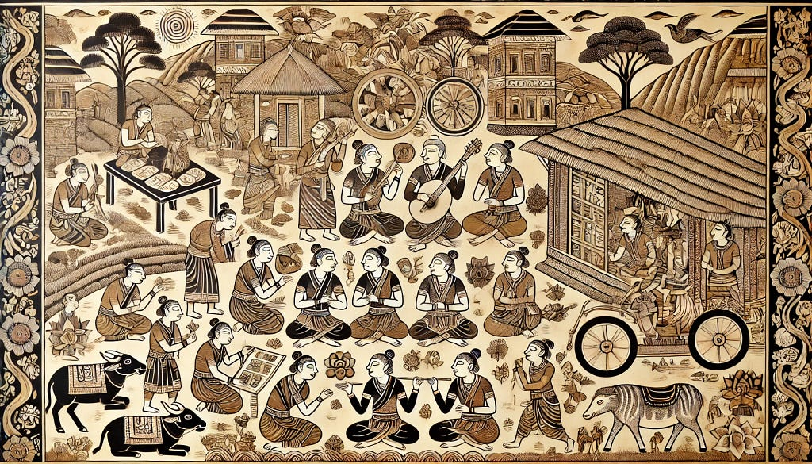
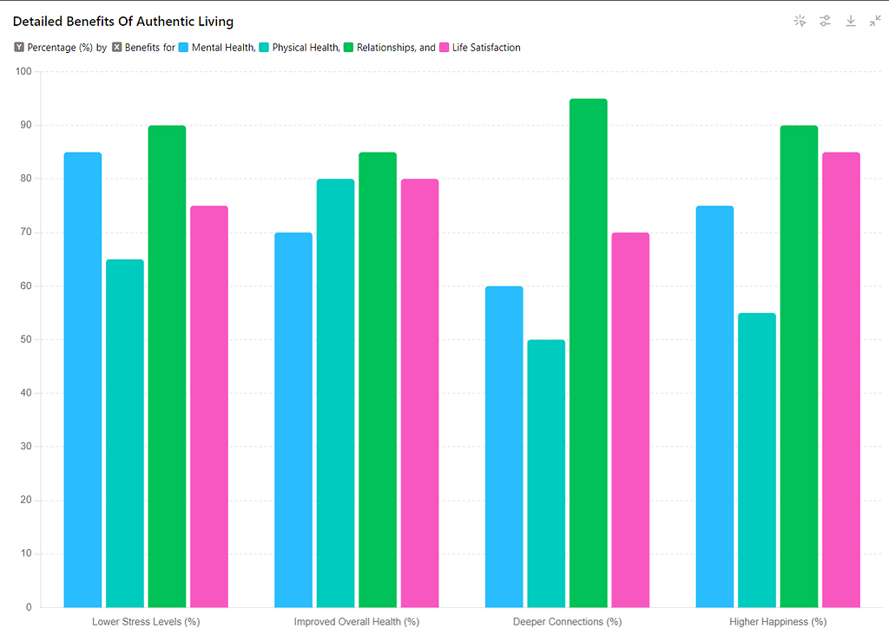

*Traditional Mural art depicting people from diverse backgrounds engaged in various joyful activities.*

> ***When death finds you, may it find you alive. Alive means living your own damned life, not the life that your parents wanted, or the life some cultural group or political party or gang of some common interest wanted, but the life that your own soul wants to live.***

This African proverb, shared by Michael Meade, really hits home about living a great life. It tells us to ditch the rules and live a life that truly vibes with our soul.

These days, fear and resistance are like those annoying clingy friends. We’re scared of failing, getting rejected, and the unknown, so we avoid things that could actually make us happy. Take Sarah, for instance. She was a kickass artist stuck in a boring corporate job, terrified of disappointing her parents who wanted her to play it safe. But after a health scare, she realized life’s too short to live someone else’s dream. So, she ditched the job, chased her art passion, and found real happiness, even with the ups and downs.

### Living in the Now

The present moment is like a goldmine of chances, but we often miss out because we’re stuck on past regrets or future worries. As Thich Nhat Hanh, a wise Buddhist monk, said,

“***The present moment is filled with joy and happiness. If you are attentive, you will see it.***”

Staying present and making choices that match our true desires can lead to a life without regrets.

### Stories of Change

Take John, a hotshot lawyer who felt empty despite his success. His aha! moment came during a pro bono case, where he discovered his passion for helping marginalized communities. He changed his career focus and found deep satisfaction. Then there’s Maria, a single mom juggling multiple jobs, who found her love for cooking in a community class. Despite money struggles, she started a small catering business that brought joy and a better life to her family.

### Behind the show ( A Scientific Evidence )

Stats and research back up the perks of living authentically. Dr. Robert Waldinger, who leads the Harvard Study of Adult Development, found that happiness and long life are tied to being true to ourselves and having meaningful relationships. The study shows that people with strong personal connections are the happiest and healthiest, living the longest. The American Psychological Association also says that living authentically lowers stress and boosts life satisfaction.

Here’s a table summarizing key findings from various studies:

| Aspect | Benefits |
| --- | --- |
| Mental Health | Lower levels of stress and anxiety |
| Physical Health | Improved overall health and longevity |
| Relationships | Deeper, more meaningful connections |
| Life Satisfaction | Higher levels of happiness and fulfillment |

The graph below illustrates the positive correlation between authentic living and various aspects of life satisfaction.

*DETAILED ANALYSIS ON BENEFITS OF AUTHENTIC LIVING*

### Real stats on living your best life

Harvard’s longest-running study on happiness says it all: strong relationships make you happier and healthier. This 85-year-long study found that people with solid personal connections are not just happier, but they also live longer. They stress that “social fitness” is as important as hitting the gym for a long, healthy life.

The World Economic Forum also found that staying healthy later in life is a big deal for most folks. Their survey shows that close personal relationships can reduce the negative health impacts of stress and loneliness, just like quitting smoking or losing weight. Basically, our social connections are super important for our overall well-being and longevity.

### A simpler tips for Rocking it.

Living authentically takes some effort, but it’s worth it. Here are some tips to get you started:

-   **Self-Reflection:** Take some time to figure out what you really want. Journaling and meditation can help.
-   **Set Boundaries:** Learn to say no to things that don’t make you happy. Focus on what brings you joy.
-   **Take Risks:** Step out of your comfort zone. Go for opportunities that scare and excite you.
-   **Seek Support:** Surround yourself with people who encourage you to be your true self. Join communities with similar interests.
-   **Practice Mindfulness:** Stay present and make choices that align with your values. Mindfulness can keep you grounded.

Living life to the fullest means going beyond fear and resistance, focusing on our true desires, and making decisions we won’t regret. It’s about living the life we want, not what others expect. As the proverb says, when death finds us, may it find us truly alive, having lived our own damned life to the fullest.

In the end, the choice is ours. We can either live in fear and resistance, or embrace the freedom and joy of living authentically. Let’s choose to live fully, courageously, and authentically, creating a life filled with passion, purpose, and satisfaction.

### Summarization from (References):

1.  **Harvard Study of Adult Development:** Findings on the correlation between authenticity and life satisfaction.
2.  **American Psychological Association:** Reports on the mental health benefits of living authentically.
3.  **World Economic Forum:** Survey on maintaining health in later life and the importance of social connections.

***Credits Note****: I would like to thank* *Gowtham .C* *who inspired me to think on this !!!*
