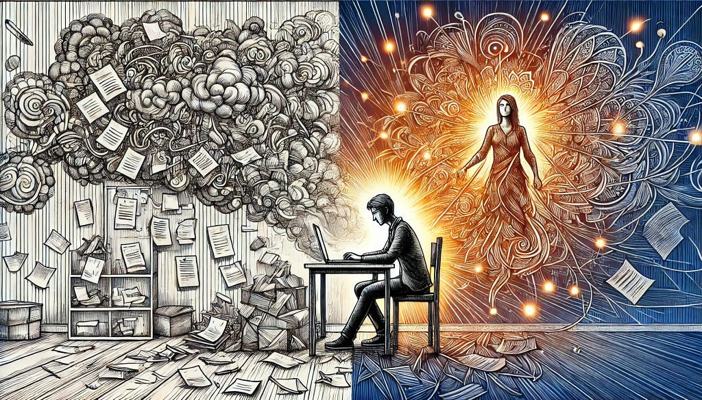

For ages, overthinking has been cast as the antagonist in the narrative of self-improvement. It’s been branded a destroyer of efficiency, a cloud over clarity, even a harbinger of anxiety. But pause — yes, take a deliberate pause — and muse upon this paradox: what if overthinking, so often maligned, is actually an uncelebrated ally in the pursuit of excellence? The reality may surprise you: what the world derides as “overthinking” may well be the crucible for insight, innovation, and mastery.

*Juggling thoughts — torn between career and a love to repair*

## Redefining Overthinking: A Fresh Perspective

> **Overthinking is not the enemy; underthinking is.**

In a society that exalts split-second decisions and glorifies instinctive action, deep deliberation has been unfairly vilified. Yet history brims with luminaries who embraced prolonged contemplation to shape destiny. Consider Einstein, who famously declared, “If I had an hour to solve a problem, I’d spend 55 minutes thinking about it and five minutes solving it.” This epitomizes the zenith of overthinking — the meticulous unraveling of complexities to illuminate their essence.

Contrary to popular belief, overthinking doesn’t paralyze; it polishes. It equips the thinker to transition uncertainty into assurance, converting ambiguity into acumen. Far from a flaw, overthinking is a finely tuned lens, transforming the chaotic into the comprehensible.

## The Over thinker’s Arsenal for Greatness

### 1\. The Unseen Potential of Exhaustive Analysis

Though overthinking may feel like treading water, it’s akin to a disciplined marathon, fortifying mental resilience. Those who immerse themselves in minute details uncover subtleties often missed by the casual observer. Overthinking enables:

-   **Risk Anticipation**: Where others skim the surface, overthinkers probe the depths, preempting disasters through their foresight.
-   **Boundless Creativity**: Questioning the mundane births innovation. Over thinkers dismantle conventions and often stumble upon ideas that defy the ordinary.

Consider Steve Jobs: his obsession with precision and seemingly “excessive” attention to design minutiae crafted products that transcended utility, offering enchantment. His overthinking wasn’t indulgence — it was a masterpiece in the making.

### 2\. Overthinking as a Strategic Superpower

> **To overthink is to think smarter.**

Overthinking grants a panoramic vista of problems, revealing angles invisible to haste-driven minds. It transforms intricate challenges into solvable puzzles by enabling:

-   **Strategic Foresight**: Much like a chess grandmaster anticipating every potential countermove, over thinkers navigate scenarios with unmatched preparedness. Victory becomes less about chance and more about calculation.

### 3\. Channeling Anxiety into Illumination

Anxiety, often intertwined with overthinking, can be reframed. What if that nervous energy is your mind urging thoroughness? Harnessing this dynamic can lead to:

-   **Sharper Questions**: Anxiety stems from the unknown; overthinking digs deeper, unearthing answers hidden beneath layers of doubt.
-   **Bulletproof Plans**: A true over thinker crafts strategies robust enough to adapt to the unpredictable, ensuring resilience against adversity.

## Guiding the Double-Edged Blade of Overthinking

When unmanaged, overthinking spirals into chaos. But channeled with intention, it becomes a sharpened instrument for growth. Mastery lies in wielding it judiciously.

## Set Parameters for Thought Exploration

Even the most skilled over thinkers set boundaries. Effective techniques include:

-   **Timeboxing**: Dedicate a specific duration to ruminate on a problem. When the timer ends, shift gears to action. This keeps analysis in check.
-   **Mind Mapping**: Organize cluttered thoughts into structured clarity by jotting them down. Writing transforms nebulous fears into tangible insights.

## Reframe Overthinking as Introspection

Words matter. Instead of saying, “I’m overthinking,” declare, “I’m deeply reflecting.” This shift alters perception and unlocks growth:

-   **Elevated Decision-Making**: Thorough analysis leads to choices rooted in wisdom, not impulse.
-   **Personal Evolution**: Reflecting on past missteps ensures they remain lessons, not patterns.

## Fuelling Creativity with Overthinking

Relentless contemplation has ignited humanity’s greatest breakthroughs. Salvador Dalí’s surrealism stemmed from his “paranoiac-critical” method of embracing imagination’s chaos. Overthinking, at its zenith, births the extraordinary.

## Overthinking Amidst the Modern Deluge of Data

In our age of ceaseless information and urgent decisions, overthinking emerges as a beacon of discernment. Here’s why:

-   **Clarity Amid Complexity**: While many drown in choices, overthinkers sift the noise to extract profound insights.
-   **Deep Learning**: Analyzing knowledge thoroughly turns fleeting facts into enduring wisdom.

## Celebrating the Titans of Overthinking

History’s geniuses were often serial over thinkers:

-   **Marie Curie**: Her meticulous rigor led to paradigm-shifting discoveries in radioactivity.
-   **Nikola Tesla**: A relentless perfectionist, Tesla’s overthinking propelled his inventions into a future few could fathom.
-   **Oprah Winfrey**: Her profound analyses during interviews fostered connections that redefined modern media.

## The Irony of Overthinking Critics

Isn’t it curious? Those quick to chastise overthinkers often rely on them for the very clarity they mock. Over thinkers shoulder the weight of progress, while their critics bask in its rewards. It’s overthinkers, after all, who sculpt the path forward.

## Embrace the Art of Overthinking

In a culture fixated on speed and simplicity, overthinking dares to challenge convention. It’s not a curse — it’s a craft, a deliberate rebellion against mediocrity. To overthink is to strive for depth, to seek greatness amidst the ordinary.

So, the next time someone says, “Stop overthinking,” smile knowingly and reply, “I’m thinking better.” Overthinking is not the adversary; it is the architect of brilliance.
