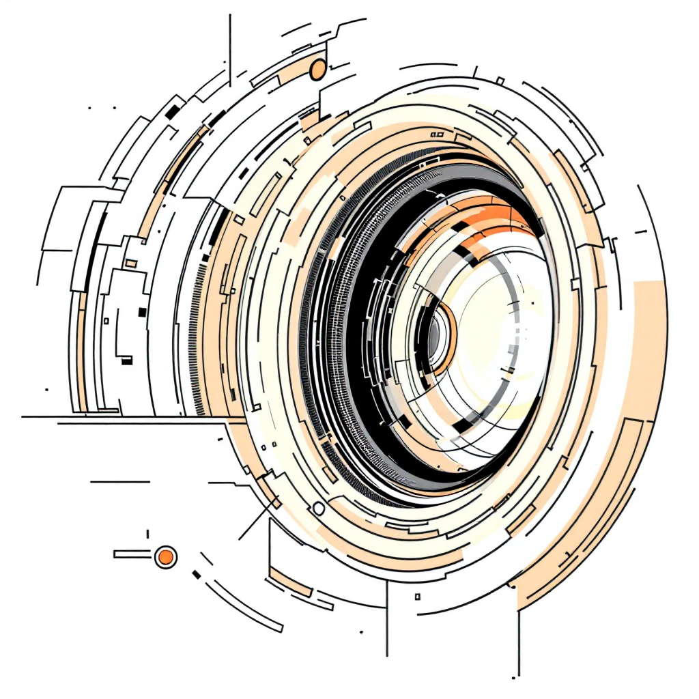
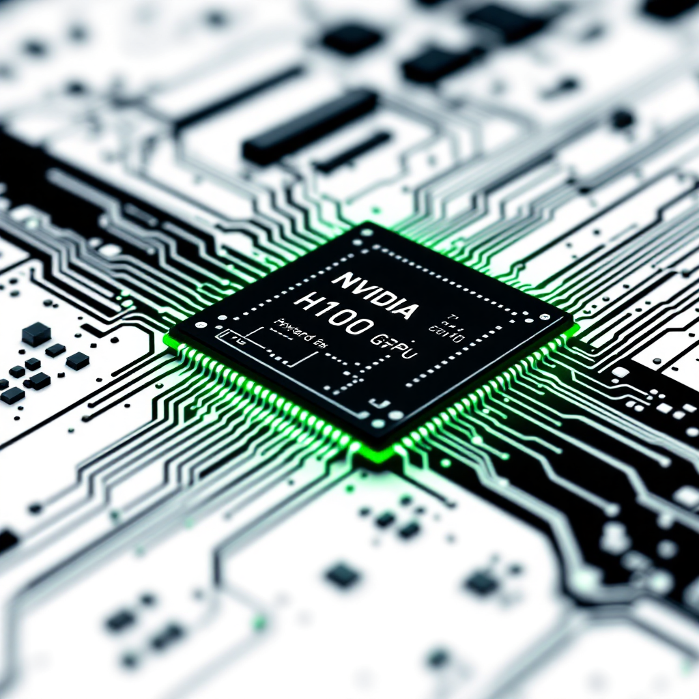
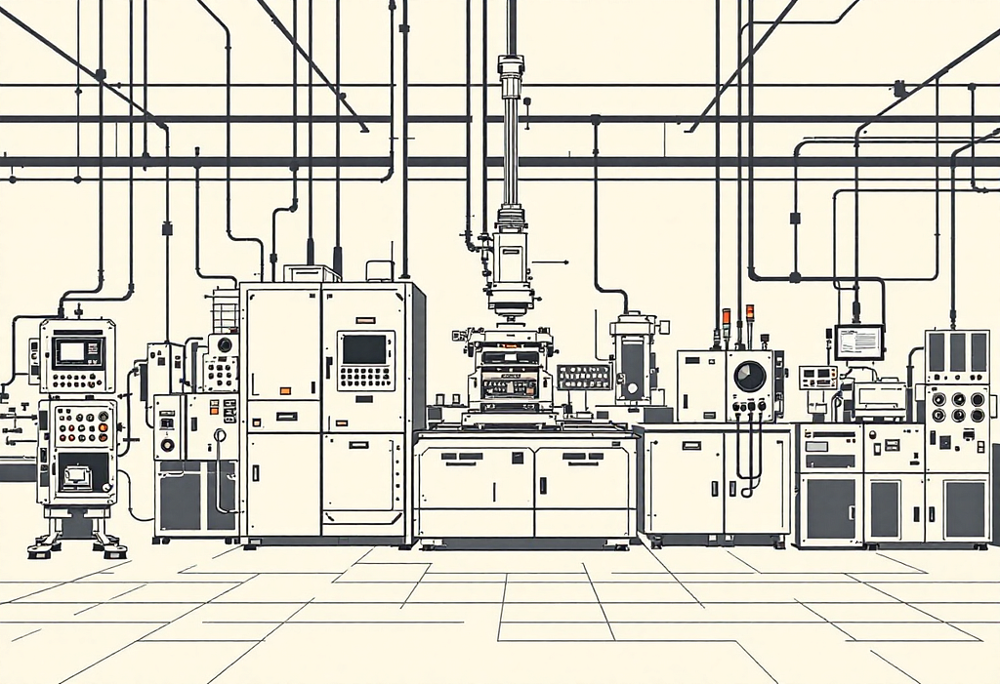
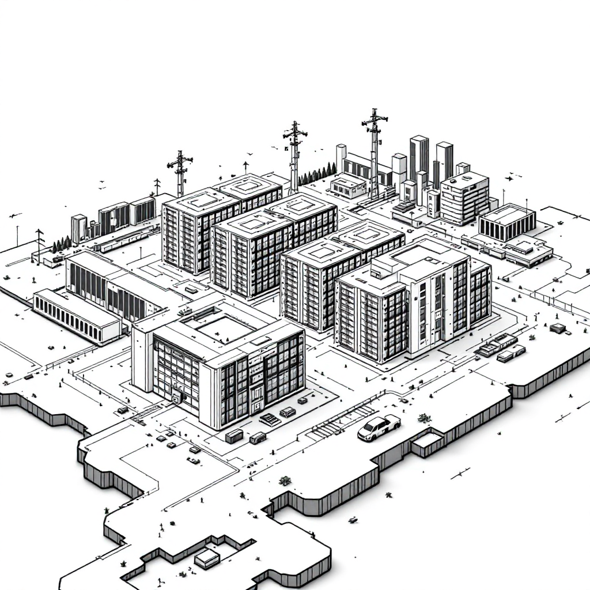
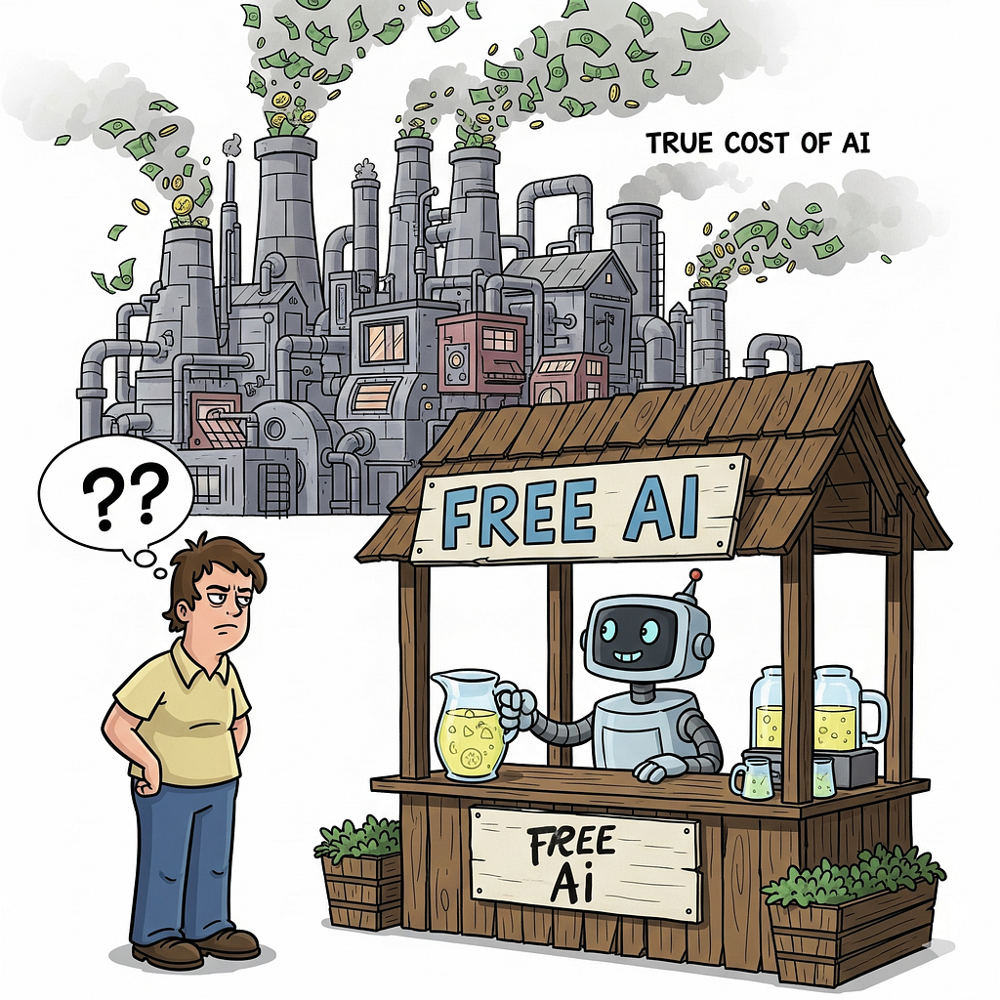

Ever thought about why those AI prompts aren’t really free? Behind every query, there’s a big, complex and very costly supply chain at work. From the device in your hand to the data centres and the power plants that run them, each step needs massive infrastructure and investment. In short, every answer you get travels through a chain that costs billions to build and maintain. Let’s break down this economic cycle, layer by layer.

## Your First Step: The AI App Subscription
It all starts with you. When you subscribe to an AI service, whether it’s ChatGPT, Copilot, or any premium app you might pay something like $20 a month (~Rs 1800 per month). It feels manageable, but that fee is just the first drop in a very large ocean of costs. You’re not only paying for a neat interface or smart replies you’re helping fund a massive global setup behind the scenes.

Think of the app as your personal doorway to advanced AI. You type a prompt, and the app turns it into a request that travels across countries and hits powerful computers to process it. Your subscription keeps that whole engine running so your assistant is always ready to answer, create, and support you on demand.

## From App to AI Powerhouse: API Usage Fees
That AI app you’re using doesn’t run the large language model on its own. It pays model providers like OpenAI to use their APIs. Each time you ask a question or generate an image, your app sends a request to OpenAI’s servers. Those massive, pre-trained models do the heavy lifting and send the result back.

These API calls cost money. Providers charge based on things like how many tokens (the bits of text) are processed, how complex your request is, and which model you pick. It’s a pay as you go system that scales with demand,so as usage grows, so do the bills.

> **What’s an API?**

> An API is like a waiter in a restaurant. You (the app) tell the waiter (the API) what you want (your prompt), and the waiter goes to the kitchen (OpenAI’s models) to get it for you, without you needing to know how the kitchen works.

## The Cloud Giants: OpenAI’s Bill to Microsoft Azure

Here’s where the costs really shoot up. To run its cutting-edge AI models and handle huge API traffic, OpenAI leans heavily on cloud infrastructure primarily Microsoft Azure and pays a serious amount for compute.

1.  **Massive compute:** These models need hundreds of thousands of GPUs running round the clock.
2.  **Billions in spending:** Industry estimates put OpenAI’s Azure bill at over $9B in 2024, possibly heading towards ~$13B in 2025.
3.  **Global reach:** Azure’s worldwide network ensures fast, reliable access for users everywhere.

And it’s not just raw processing power. That spend also covers storage, networking, and advanced management tools that keep these complex AI systems stable, secure, and scalable.

## The Engine Room: Microsoft Pays NVIDIA for Accelerators

So, where do those billions going into Microsoft Azure actually go? At the heart of AI computing is specialised hardware GPUs (or more precisely, AI accelerators). And in this space, NVIDIA is the clear leader.

Microsoft pours money into NVIDIA’s top-end accelerators like the H100, H200, and the newer B-series. These aren’t gaming cards they’re purpose-built for heavy parallel processing, which is exactly what modern AI needs for training and inference.Each chip can cost around $20,000–$35,000, and data centres need them in the thousands. On top of that, you have the servers, cooling, networking, and support. No surprise, then, that NVIDIA’s valuation has surged this is the hardware gold rush powering the AI boom.Because NVIDIA dominates AI accelerators, it’s both a key beneficiary and a practical bottleneck in the AI supply chain. Without these chips, the current scale and speed of AI simply wouldn’t be possible.

## The Fabrication Masters: NVIDIA Pays TSMC

NVIDIA designs these powerful AI chips, but it doesn’t manufacture them. That job goes to Taiwan Semiconductor Manufacturing Company (TSMC) the world’s top chip foundry and the place where the real silicon magic happens.

**Wafer starts:** NVIDIA pays TSMC for “wafer starts,” the silicon discs on which thousands of chips are made.

**Leading-edge costs:** Each cutting-edge wafer can cost around $20,000–$25,000, because the manufacturing process is incredibly complex.

**Advanced packaging:** After fabrication, TSMC also handles high-end packaging like CoWoS (Chip-on-Wafer-on-Substrate), which adds thousands more per chip to integrate everything properly.

TSMC’s role is critical. They have the specialised tools and talent to build the tiny, intricate transistors inside modern chips. Their factories (fabs) are among the most advanced and most expensive in the world.

## The Unsung Heroes: TSMC Pays Tool Makers

TSMC’s scale doesn’t come out of thin air. It runs on a tight ecosystem of ultra-specialised equipment makers , the folks who supply the precision tools to etch, deposit, and test those microscopic features on silicon wafers.

**ASML EUV scanners:** The crown jewels. ASML’s Extreme Ultraviolet lithography machines priced roughly $200–$350 million each are essential for making the smallest, most advanced chips.

**Etch & deposition:** Companies like Applied Materials and Lam Research supply the gear that adds and removes materials on the wafer with pinpoint accuracy worth billions in spend.

**Metrology & inspection:** KLA’s tools verify dimensions and defects so every chip meets spec crucial for yield and reliability.

These tool makers sit at the absolute frontier of engineering. Their innovations directly enable higher chip density and performance the very gains that power today’s AI.

## Micro-Components, Macro Costs: Optics & Memory

The complexity doesn’t end with the big machines. Inside those tools, there are ultra-specialised parts and they’re pricey. On top of that, memory is a major cost in AI hardware.

**ASML’s key suppliers**

> **ZEISS (EUV optics):** Provides the ultra-precise optics that project patterns onto silicon. Each optics module can cost tens of millions of dollars. **TRUMPF (high-power lasers):** Supplies the lasers that generate EUV light again, systems priced in the tens of millions.

**NVIDIA’s HBM memory**

> AI accelerators need extremely fast memory to keep the cores fed. NVIDIA buys High Bandwidth Memory (HBM) from **SK hynix, Samsung,** and **Micron**.Each **80–96GB HBM stack** is roughly **$1,000–$3,000**.High-end GPUs usually carry **6–8 stacks**, adding **tens of thousands of dollars** to the cost of a single accelerator.

All these specialised components are what let the whole system run at peak performance but they also push costs up significantly.

## Building the Digital Frontier: Azure Data Centers & Infrastructure

All those chips and tools finally come together in giant AI data centres run by cloud providers like Microsoft Azure. These aren’t just big buildings they’re highly engineered facilities built to host and power thousands of AI accelerators. First comes the land and the core campus construction major upfront investment before a single server goes in. Building out just **1 MW** of data centre capacity can cost around **$10–15 million**. Flagship AI campuses run into the **hundreds of MW**, pushing total costs into the **billions**.You need industrial-grade electrical systems switchgear, UPS, and PDUs from players like **Eaton, Schneider, Siemens**. Cooling is its own beast: modern **liquid cooling** (Vertiv/CoolIT/JCI) can cost **$10,000+ per rack**, and a full site can run into **hundreds of millions**. To stitch together thousands of GPUs, you need ultra-fast **InfiniBand or Ethernet** networks with top end switches and NICs from **NVIDIA or Broadcom**. A dense AI pod can easily carry **$1 million+** of networking per row.

In short, these data centres are precision-built environments optimised for maximum compute and energy efficiency pushing the limits of industrial design, power engineering, and construction.

## The Ultimate Cost: Electricity to Run It All

Here’s the real bottom line: electricity keeps the whole AI engine running and it’s not cheap.

**Power costs:** Utilities and grid operators (ISO/RTO) typically charge about **$0.05–$0.15 per kWh**.

**Server draw:** A typical **8-GPU server**, including cooling (factored via **PUE**), uses roughly **5–6 kW** so that’s **5–6 kWh every hour** it’s on.

**Transmission losses:** Moving power across the grid wastes about **5–8%**, which further lifts total demand.

> **Where does this electricity come from?**

> **Natural gas:** Backed by major suppliers like **Shell, Exxon, Chevron**.

> **Nuclear:** Fuelled by **uranium** (think **Cameco**) and enrichment capacity.

> **Hydro:** Large dams providing steady baseload.

> **Wind:** Projects from developers like **Ørsted**.

> **Solar:** Players like **NextEra** and others scaling up rapidly.

## See the challenge now?
The moment you hit “**send**” on an AI prompt, a massive, multi-billion-dollar supply chain springs into action right down to the power plants generating the electricity. This entire web of technology, infrastructure, and raw materials is why your prompt actually carries a very real and very expensive cost.
